<!-- Profile -->

## 👨‍💻 About Me

### 🚀 Tech Stack

#### 🤖 Languages & Frameworks

### 🧪 Tools

---

## 📈 GitHub Insights

  
  

  
  

<h3 align="center">🐍 Snake Contribution Grid</h3>

  <picture>
    <source media="(prefers-color-scheme: dark)" srcset="https://raw.githubusercontent.com/33alireza/33alireza/output/github-contribution-grid-snake-dark.svg">
    <source media="(prefers-color-scheme: light)" srcset="https://raw.githubusercontent.com/33alireza/33alireza/output/github-contribution-grid-snake.svg">
    
  </picture>

---

## 📂 Featured Projects

### 🎬 [Movino](https://github.com/33Alireza/Movino)

A modern Android movie discovery application built entirely with **Jetpack Compose**.

**Tech:** Kotlin · Jetpack Compose · MVVM · Coroutines · Flow · Ktor Client · Dagger Hilt · Type-safe Navigation

---

### 🟣 [KotlinFinity](https://github.com/33Alireza/KotlinFinity)

A collection of **Kotlin fundamentals, examples, and explanations** designed to help developers learn Kotlin from the ground up.

> Learn. Build. Explore. Kotlinfinity.

---

### 🤖 [AndroidBeyond](https://github.com/33Alireza/AndroidBeyond)

A personal Android development knowledge base where I document and experiment with things I learn while developing with **Kotlin and Jetpack Compose**.

---

### 🗺️ [Mobile Development Roadmap](https://github.com/33Alireza/MobileDevRoadmap)

An open-source roadmap covering the journey of becoming a mobile developer, from fundamentals to modern **Android and iOS development**.

## 📫 Get in Touch

  

Feel free to reach out if you want to collaborate on a project or just want to chat about Android development!

## 🤝 Let's Connect!

I'm always open to learning and collaborating with others. If you have any suggestions or feedback, please let me know!

---

Thank you for visiting my GitHub profile! 😊
